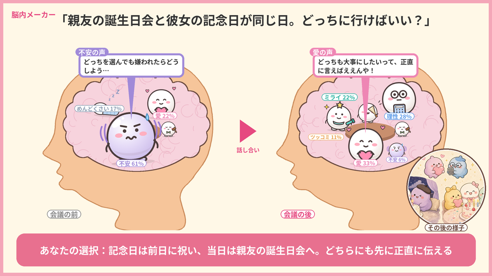
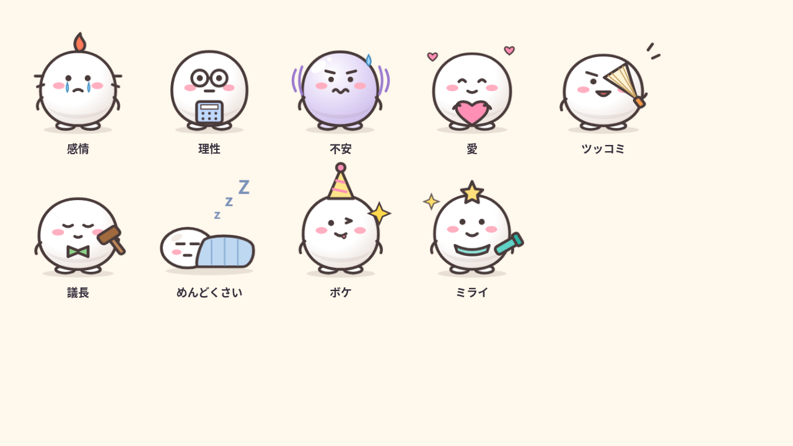

# 脳内会議カード

迷ったときに頭の中でぶつかる「感情」「理性」「不安」「愛」などの気持ちをキャラクターにして話し合わせた結果を、「会議の前」と「会議の後」の頭の中を並べた 1200×675 の画像（そのままXに貼れるサイズ）にします。#GrokBotTokyoHackathon の作品「脳内会議」の部品です。

## クローンして、このコマンド1つでカードが出る

```
git clone https://github.com/miyayu-jp/nounai-kaigi.git
cd nounai-kaigi
python3 -m venv .venv && . .venv/bin/activate && pip install -r requirements.txt
python3 card.py examples/sample_meeting.json out.png
```

`out.png` に、上の見本と同じカードができます（1〜2秒）。

- Python 3 と日本語フォントが必要です。APIキーは要りません。
- Mac はヒラギノを自動で使います。Linux は `fonts-noto-cjk`（例：`sudo apt install fonts-noto-cjk`）を入れてください。
- フォントが見つからないときは、環境変数 `NOUNAI_FONT` にフォントファイルのパスを入れます。

## このHTMLを開くとアニメが見られる

`anim/nounai-kaigi-mock-v4.html` をブラウザで開くと、悩みの入力から、キャラたちの会議、脳内もちつき、会議の前と後のカードまでの画面が動きます（「次へ」か矢印キーで進み、URLの最後に `?autoplay=1` を付けると自動再生）。ファイル1つで動き、外とは通信しません。

```
open anim/nounai-kaigi-mock-v4.html
```

（Mac の場合。Windows はファイルをダブルクリック、Linux は `xdg-open`）

- 画面に出ている「モック（デモ用）・Grok Botでの動作は未検証」のとおり、これはデモ用の画面で、セリフは台本（案）です。
- 動画もあります：`anim/nounai-kaigi-demo-v4.mp4`（会議のデモ、約87秒）、`anim/E_animation.mp4`（もちもち脳内ちゃんのアニメ、33秒）。
- もちもち脳内ちゃんのアニメ（`E_animation`）の HTML 版は準備中です。今は動画だけ入っています。

## JSONの形

```json
{
  "worry": "親友の誕生日会と彼女の記念日が同じ日。どっちに行けばいい？",
  "before": {
    "weights": {"不安": 55, "愛": 20, "めんどくさい": 15, "議長": 10},
    "quote": {"name": "不安", "text": "どっちを選んでも嫌われたらどうしよう…"}
  },
  "after": {
    "weights": {"愛": 30, "理性": 25, "ミライ": 20, "ツッコミ": 10, "不安": 5, "議長": 10},
    "quote": {"name": "愛", "text": "どっちも大事にしたいって、正直に言えばええんや！"}
  },
  "conclusion": "記念日は前日に祝い、当日は親友の誕生日会へ。どちらにも先に正直に伝える",
  "image": "after.jpg"
}
```

| キー | 中身 |
|---|---|
| `worry` | 悩みの一言（カードの上に出ます） |
| `before` / `after` | 会議の前と後。`weights` はキャラ名と割合（合計100でなくてよい）、`quote` は吹き出し1つ（`{"name": キャラ名, "text": 一言}`） |
| `conclusion` | 本人が選んだこと（下の帯に「あなたの選択：」として出ます） |
| `image` | 任意。「その後の様子」の画像のパス（JSONからの相対パスでよい）。右下に丸く入ります。なければ丸なしで出ます |
| `char_images` | 任意。キャラの絵を差し替えるとき `{"不安": "絵/fuan.png"}` のように書きます |

- 用意してあるキャラ：感情・理性・不安・愛・めんどくさい・ボケ・ツッコミ・議長・ミライ（`chars/`）。
- それ以外の新しい名前（例：「お金」）もそのまま描けます（絵がない名前は、代わりのキャラで出ます）。
- 議長は割合に入れても数えず、テーブルの端に司会として小さく座ります。
- もう1つの例：`examples/demo_meeting.json`（キャラ8体＋ミライ）。

## Grok Bot に入れる

`skills/nounai-card/` フォルダ（または中の `SKILL.md`）を、自分の Grok Bot にスキルとして渡してください。会議が終わって本人が選んだあと、Grok Bot がこのリポジトリを取ってきて、結果の JSON を書き、`card.py` でカードを作って返します。スキルの一覧は `skills/README.md` にあります。

## ファイル

| ファイル | 役割 |
|---|---|
| `card.py` | 前後カードを作る本体 |
| `nm_font.py` | 日本語フォントを探す |
| `chars/` | キャラクターの絵（もちもち脳内ちゃん 9体） |
| `examples/` | 見本の JSON と画像 |
| `anim/` | 画面モック（HTML）とデモ動画 |
| `skills/` | Grok Bot に入れるスキル（`skills/nounai-card/SKILL.md` など） |

## ライセンス・クレジット



- **コード**（`card.py` ほか）は MIT ライセンスです（[LICENSE](LICENSE)）。
- **キャラクターデザイン「もちもち脳内ちゃん」とアニメーション**（`chars/`、`anim/`、それらを使った `docs/` と `examples/` の画像）は、チームメンバーの遠藤さんによるもので、許可を得て掲載しています。MIT ライセンスの対象外です。
